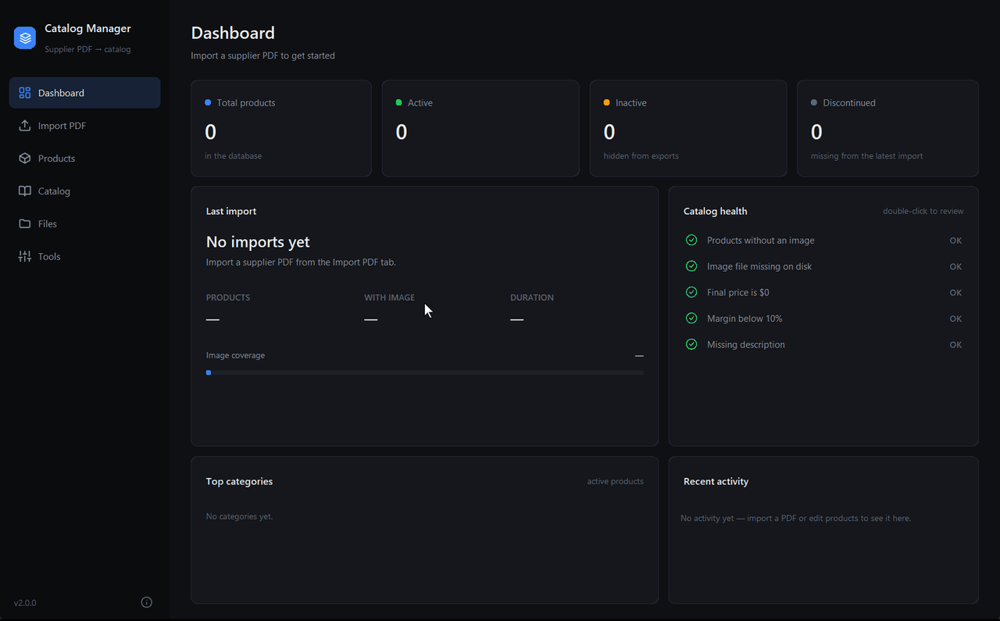
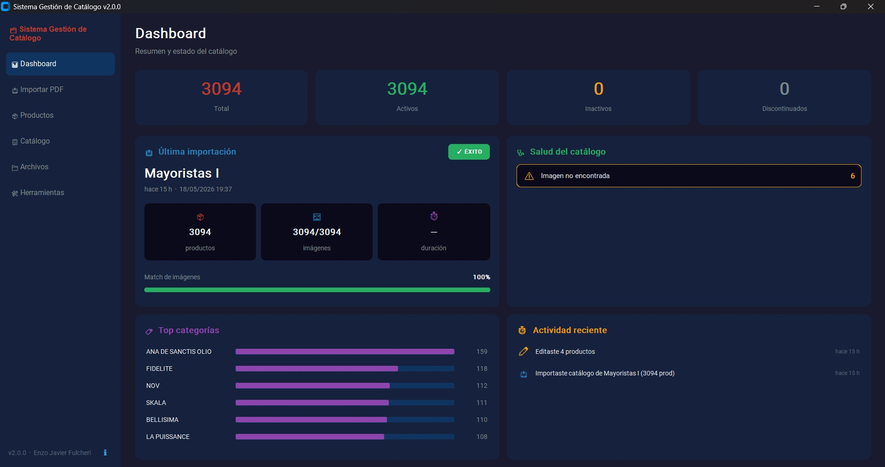
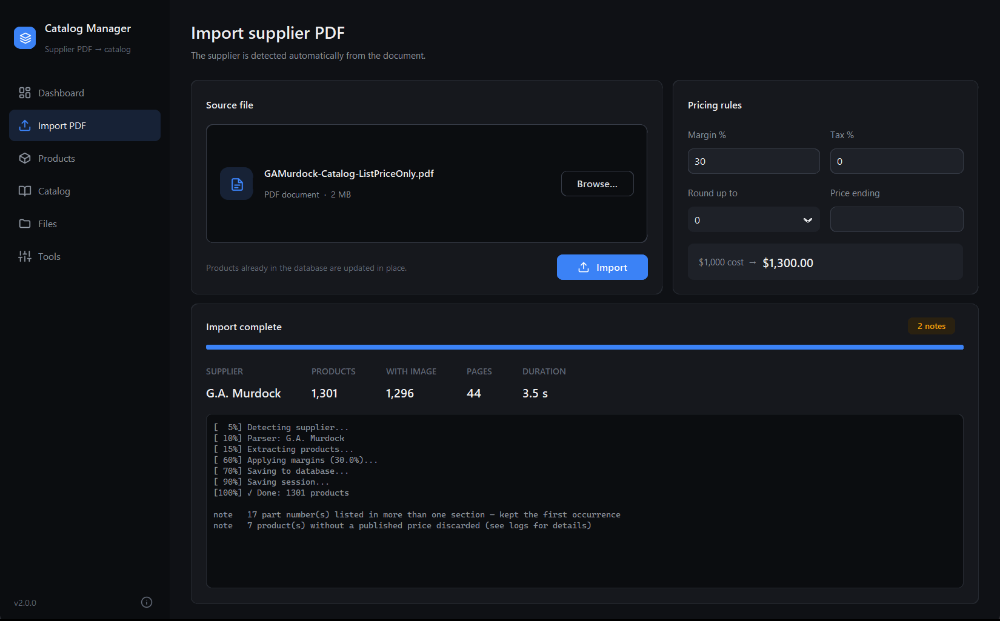
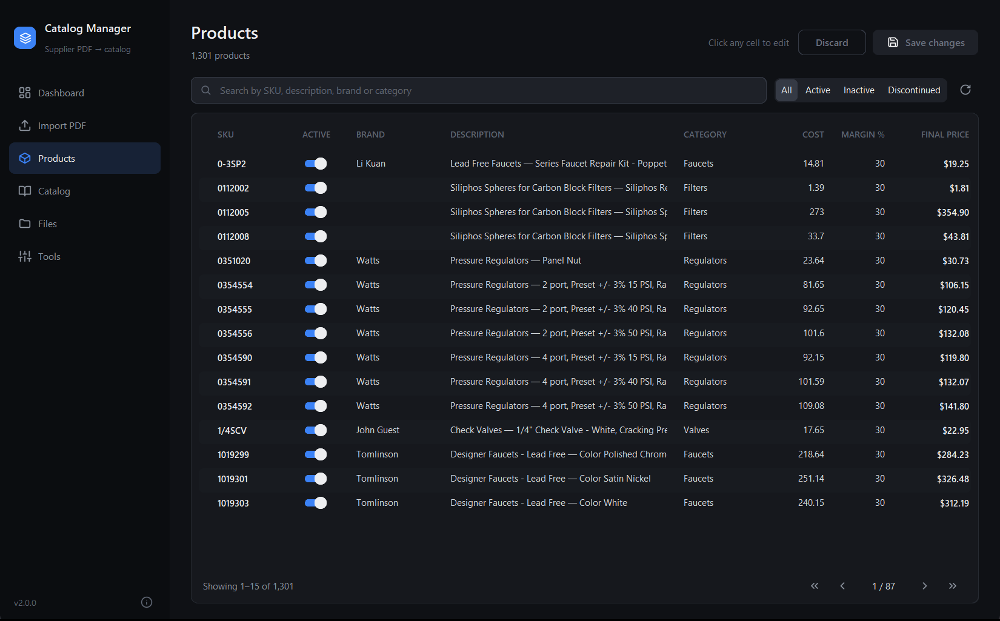
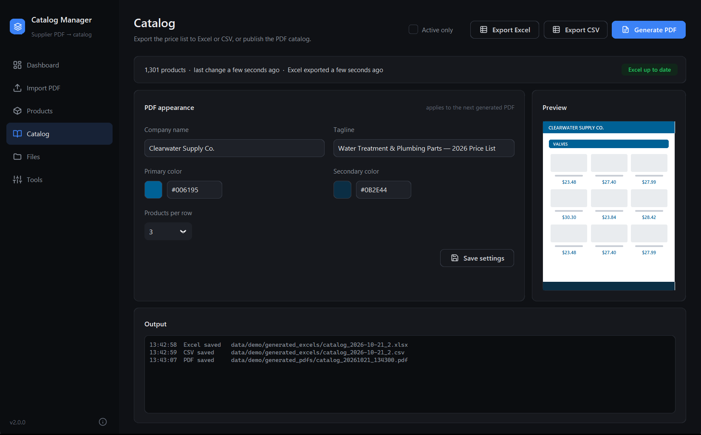
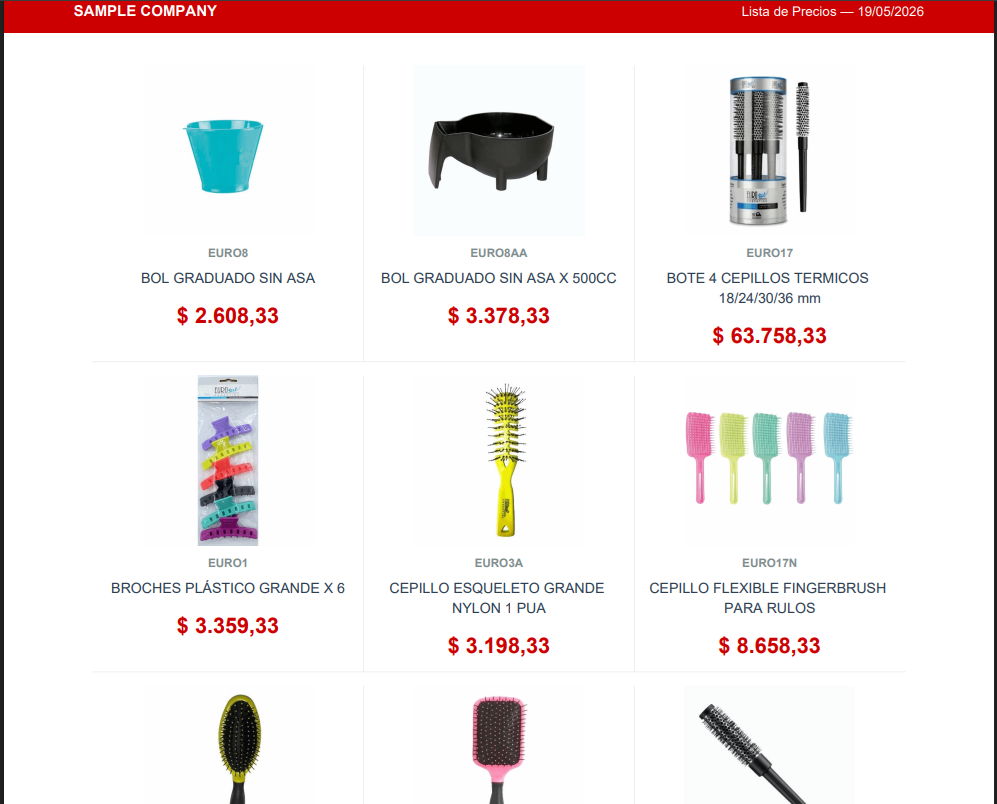

# Catalog Manager

> Desktop application that automates the full pipeline from supplier price-list PDFs to customer-ready commercial catalogs — extraction, pricing, editing, and publishing in one tool.

[](https://www.python.org/)
[](#testing)
[](LICENSE)
[](#)

A production-grade Python desktop application built for a wholesale distribution business. It ingests 400+ page supplier PDFs, extracts thousands of products and their images, applies pricing rules (margins, tax, rounding), and produces an editable Excel snapshot, a plain CSV for other systems, and a polished, customer-facing PDF catalog — all from a single dark-mode UI.



> End-to-end flow on a 44-page US wholesale price list: 1,301 products and
> their photos imported in 3.5 s, priced with a 30% margin, and published as
> an Excel price list plus a 129-page branded PDF catalog.

---

## Table of Contents

- [Why this project](#why-this-project)
- [Key Features](#key-features)
- [Screenshots](#screenshots)
- [Tech Stack](#tech-stack)
- [Architecture](#architecture)
- [Installation](#installation)
- [Usage](#usage)
- [Project Structure](#project-structure)
- [Testing](#testing)
- [Performance](#performance)
- [Extensibility](#extensibility)
- [License](#license)
- [Author](#author)

---

## Why this project

Wholesale distributors receive massive PDF price lists from their suppliers — often 300 to 500 pages — and need to republish them to their own customers with custom pricing, branding, and product selection. Doing this by hand takes **days** every month.

This tool reduces that to **minutes**: drop in the supplier PDF, the app detects the supplier, extracts every product (SKU, brand, description, price, image), applies the configured pricing rules, and lets the user fine-tune the catalog through an inline-editable table before generating the final Excel and PDF deliverables.

It is currently deployed in production for an Argentinean wholesale business and processes a 400-page, 3,000-product catalog end-to-end in under two minutes. It also ships with a parser for a US water-treatment and plumbing supplier (English, USD), which is the catalog used in the demo and screenshots below.

---

## Key Features

### Data ingestion
- **Automatic supplier detection** through a pluggable parser registry — adding a new supplier means writing one class
- **PDF parsing** with PyMuPDF: extracts product rows by analyzing text-position coordinates, not regex on bare strings
- **Image-to-product binding** by bounding-box overlap, with confidence scoring
- **Duplicate-import detection** that warns the user when the same PDF was already processed

### Product management
- **Persistent state across imports**: products manually deactivated stay deactivated even when re-importing the source PDF
- **Discontinued-product tracking**: SKUs that disappear from a new import are auto-flagged, never silently deleted
- **Inline editable table** with batched-save flow (edit dozens of fields, then commit once)
- **Search and filtering** with debounced query, plus health-based filters (no image, zero price, low margin, missing description)

### Pricing engine
- Configurable margin %, VAT, rounding-to-nearest, and price suffixes
- One-call recalculation across the entire active catalog
- Re-importable Excel: clients can edit the Excel offline, then push changes back into the database

### Output generation
- **Branded PDF catalog** with cover page, category dividers, configurable product grid (1/2/3 per row), and per-page headers/footers
- **Excel export** with two sheets: a clean product sheet and a "System" sheet with audit metadata and integrity flags
- **CSV export** with the same columns, UTF-8, dot decimals and no currency symbols — ready to import into an ERP, e-commerce store or database
- Branding (company name, tagline, primary and secondary colors, products per row) configurable from the UI, with a live preview

### UX polish
- Dashboard with live health metrics, recent-activity feed, and a last-import summary card
- Health-chip double-click → opens the Products tab pre-filtered to the affected rows
- Filesystem watch: detects images manually deleted from the extracted-images folder and surfaces them as a health alert
- Tooltips on every non-obvious control, with smart screen-edge positioning
- Threaded long-running tasks (imports, PDF generation, Excel export) keep the UI responsive throughout

---

## Screenshots

### Dashboard


> Dashboard after importing a 1,301-product US supplier catalog: last-import
> summary with image coverage (99.6%), catalog-health checks (including a
> filesystem check for images deleted from disk), top categories, and an
> activity feed that collapses consecutive events within a 5-minute window.

### Import with pricing rules


> The supplier is detected from the PDF itself. Margin, tax, rounding and price
> ending are previewed live before importing. Anomalies are reported as notes
> instead of being dropped silently — here, part numbers listed in more than
> one section and rows without a published price.

### Products — inline editing


> Inline-editable product table with batched save. Changed rows are highlighted
> until committed. An empty Brand cell reflects honest data: blank when the
> supplier's PDF didn't specify a brand, not a fallback.

### Catalog generation


> The status badge tracks Excel/PDF staleness against the database. Company
> name, tagline, colors and product-grid density are configurable, with a live
> preview of the page layout.

### Generated PDF output


> A page from the generated 129-page catalog: branded header, 3×3 product grid
> with photos, SKUs, brands, descriptions and final prices in USD. Categories
> become section dividers across pages. The reseller name is fictitious.

---

### A note on language

The UI, the Excel export and the PDF catalog are in English. All
user-facing identity strings live in `app/config/branding.py`, and price
parsing handles both US (`$1,234.56`) and Argentine (`$ 1.234,56`) formats,
so the same pipeline serves suppliers in either market.

---

## Tech Stack

| Layer | Technology |
|-------|------------|
| Language | Python 3.11+ |
| UI | CustomTkinter (modern dark-mode Tk) |
| Database | SQLite via SQLAlchemy Core (WAL mode) |
| PDF parsing | PyMuPDF (`fitz`) — text-position-aware extraction |
| PDF generation | ReportLab — flowables, custom canvas |
| Excel I/O | openpyxl with styled cells and data validation |
| Settings | Pydantic v2 + pydantic-settings |
| Logging | Loguru with rotating files |
| Testing | Pytest (59 tests covering business logic and parsers) |
| Packaging | PyInstaller spec included for single-file Windows distribution |

---

## Architecture

The app follows a strict layered architecture. Each layer only depends on the ones below it, and the UI never touches the database directly.

```
┌──────────────────────────────────────────────────────┐
│                    UI (CustomTkinter)                │
│  Dashboard · Products · Import · Catalog · Settings  │
└────────────────────────┬─────────────────────────────┘
                         │
┌────────────────────────▼─────────────────────────────┐
│                    AppController                     │
│           single entry point for all UI calls        │
└────────────────────────┬─────────────────────────────┘
                         │
┌────────────────────────▼─────────────────────────────┐
│                       Services                       │
│  ProductService  ·  ExcelService  ·  PDFGenerator    │
└────────────────────────┬─────────────────────────────┘
                         │
┌────────────────────────▼─────────────────────────────┐
│                       Database                       │
│              DatabaseManager (SQLAlchemy)            │
└──────────────────────────────────────────────────────┘
```

### Design decisions worth highlighting

- **No ORM mapper objects** — SQLAlchemy Core only. Queries are explicit `select()` / `update()` constructs. Every DB call is auditable.
- **Activity log + visual aggregation** — every meaningful user action is appended to an `activity_log` table. The dashboard renders the last 30 entries with time-window aggregation (consecutive edits within 5 minutes collapse into one row) to avoid noise.
- **Health metrics computed on-demand**, not cached — guarantees the dashboard always reflects current state, and includes a filesystem check for manually-deleted product images.
- **Threading** — all long-running tasks (PDF parse, Excel generation, PDF generation, margin re-application) run on background threads. UI updates from those threads always go through `.after(0, ...)` to stay on the Tk main loop.
- **Pluggable parsers** — adding a new supplier is implementing one `BaseParser` subclass with `validate_pdf()`, `extract_products()`, and `extract_images()`. The factory auto-detects which parser to use from the PDF content.

---

## Installation

### Requirements
- Python 3.11 or newer
- Windows, macOS, or Linux

### Setup

```bash
# Clone the repository
git clone https://github.com/EnzoJF24/catalog-manager.git
cd catalog-manager

# Create and activate a virtual environment
python -m venv venv
# Windows:
venv\Scripts\activate
# macOS / Linux:
source venv/bin/activate

# Install dependencies
pip install -r requirements.txt

# Run the application
python main.py
```

On first launch the app creates a `data/` folder with an empty SQLite database and the subdirectories it needs.

---

## Usage

### 1 — Import a supplier PDF

1. Open the **Import** tab.
2. Set the margin %, VAT, rounding rule, and price suffix.
3. Drop or browse for the supplier PDF.
4. Click **Start Import**.

The app auto-detects the supplier, extracts all products and images, applies the pricing rules, and persists everything to the database.

### 2 — Curate the catalog

The **Products** tab lets you:
- Search and filter (Active / Inactive / Discontinued, plus health overlays)
- Edit any field inline; changes are batched and saved on demand
- Toggle products on/off — the state survives future re-imports of the same PDF
- Re-apply margin/VAT to the whole catalog in one click

### 3 — Publish

From the **Catalog** tab:
- **Export Excel** — produces a styled, two-sheet workbook (Products + System metadata)
- **Export CSV** — the same product columns as plain CSV
- **Generate PDF** — produces a branded multi-page catalog with cover, category dividers, and a 1/2/3-column product grid

---

## Project Structure

```
catalog_manager/
├── app/
│   ├── config/             # Pydantic settings + branding constants
│   ├── core/               # AppController — single API surface for UI
│   ├── database/           # SQLAlchemy Core schema + queries
│   ├── logging_config/     # Loguru setup with rotating files
│   ├── models/             # Product, ProcessingSession, MarginConfig dataclasses
│   ├── parsers/
│   │   ├── base_parser.py
│   │   ├── parser_factory.py
│   │   ├── mayoristas_i_parser.py   # Argentine wholesaler (Spanish, ARS)
│   │   └── ga_murdock_parser.py     # US supplier (English, USD)
│   ├── services/
│   │   ├── product_service.py
│   │   ├── excel_service.py
│   │   └── pdf_generator.py
│   └── ui/
│       ├── main_window.py
│       ├── theme.py        # Centralized color palette + font helpers
│       └── components/     # Sidebar, Dashboard, Import, Products, Catalog, ...
├── data/                   # Runtime data (gitignored — generated on first run)
├── tests/                  # Pytest suite
├── docs/                   # Screenshots + supplementary docs
├── main.py                 # Entry point
├── requirements.txt
└── README.md
```

---

## Testing

```bash
pytest -q
```

The suite covers the business-critical paths:
- Price-string parsing in Argentine (`$ 1.484,90` → `1484.90`) and US formats
- Margin / VAT / rounding / suffix application
- Database upsert semantics with state preservation
- Active / inactive / discontinued flag transitions across re-imports
- Excel round-trip (export → edit → re-import)
- Parser auto-detection
- Health metrics aggregation
- US supplier parser: dynamic table headers, wrapped descriptions, split and
  multi-line column labels, footnote markers, category resolution
- An end-to-end check against the real supplier PDF (every published price
  becomes a product, almost every product gets a photo) — skipped
  automatically when the PDF is not present, since source PDFs are git-ignored

All 59 tests pass on every commit.

---

## Performance

Reference numbers on two real supplier PDFs (Intel i5, SSD):

**Argentine wholesaler — 400 pages, ~3,000 products**

| Stage | Duration |
|-------|----------|
| Parser detection | < 1 s |
| Product extraction (3,000 rows) | ~3 s |
| Image extraction + binding | 60–90 s |
| Excel generation | ~2 s |
| Branded PDF generation | 15–30 s |

**US water-treatment & plumbing supplier — 44 pages, 1,301 products**

| Stage | Result |
|-------|--------|
| Full import (detection, extraction, photos, pricing, save) | 3.5 s |
| Products matched to a photo | 1,296 of 1,301 (99.6%) |
| Branded PDF catalog | 129 pages, ~10 s |

The UI stays responsive throughout — all stages run on background threads with progress reporting.

---

## Extensibility

### Adding a new supplier

The parser system is built around a registry + auto-detection pattern.
Each supplier is one class subclassing `BaseParser`; the factory picks the
right one for an incoming PDF by scanning page 1 for the parser's
`DETECTION_KEYWORDS`. No UI changes, no database migrations.

The repo ships with two artifacts to make adding a new supplier
straightforward:

- **[`docs/example_parser_template.py`](docs/example_parser_template.py)** — a
  fully commented template parser. Copy it into `app/parsers/`, rename the
  class, plug in your supplier's detection keywords and column x-coordinates,
  and you have a working parser.
- **[`docs/ADDING_A_PARSER.md`](docs/ADDING_A_PARSER.md)** — a step-by-step
  guide covering PDF layout discovery, the coordinate-based extraction
  pattern, category-header handling, image extraction, and the most common
  pitfalls.

Estimated effort to add a basic text-only parser: **2–4 hours**. Full parser
with image extraction: **1–2 days**.

---

## License

This project is released under the [MIT License](LICENSE).

---

## Author

**Enzo Javier Fulcheri**
Python developer · Buenos Aires, Argentina

- Email: enzofulcheri@gmail.com
- GitHub: [@EnzoJF24](https://github.com/EnzoJF24)

Available for freelance work — desktop applications, document-processing pipelines, business-automation tools.
