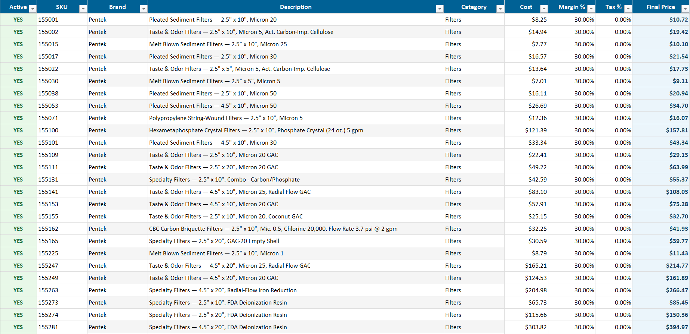

# Catalog Manager

Desktop app that turns supplier PDF price lists into priced Excel/CSV price lists and branded PDF catalogs.

[](https://github.com/EnzoJF24/catalog-manager/actions/workflows/tests.yml)
[](https://www.python.org/)
[](LICENSE)

I built it for a wholesale distributor in Argentina. Every month they get 300 to 500 page price lists from their suppliers and have to republish them to their own customers with their margins, their branding and only the products they actually sell. Doing that by hand took days. With this app it takes a few minutes: load the PDF, review the products, export.


*The demo uses a 44-page US price list: 1,301 products and their photos imported in under 4 seconds, priced with a 30% margin, then exported to Excel, CSV and a 129-page PDF catalog.*

## What it does

**Import**
- Detects which supplier a PDF belongs to and picks the matching parser.
- Extracts SKU, brand, description, category, price and product photo for every row. Values are read by their position and font on the page, not with OCR or regex over plain text.
- Matches each photo to its product by its position on the page.
- Warns you if you load a PDF that was already imported, and reports skipped rows (for example, items without a published price) instead of dropping them silently.

**Edit**
- Products tab with inline editing. Changes are saved in one batch.
- Search, and filters for active, inactive and discontinued products.
- Products you turn off stay off when you re-import the same supplier. SKUs that disappear from a new list are flagged as discontinued, never deleted.
- Dashboard with catalog health checks: products without a photo, $0 prices, low margins, missing descriptions, and photos deleted from disk. Double-clicking a check opens the affected products.

**Price**
- Margin, tax, rounding and price ending, previewed before importing.
- Re-apply a new margin to the whole catalog from the Tools tab.

**Export**
- **Excel**: a Products sheet plus a System sheet with metadata. You can edit the Excel and import it back.
- **CSV**: the same columns, UTF-8, dot decimals, no currency symbols. Ready for an ERP, an online store or a database.
- **PDF catalog**: cover, one section per category, 1 to 3 products per row, with your company name, tagline and colors.

## Screenshots

**Dashboard.** Last import, photo coverage, health checks and recent activity.


**Import.** The supplier is detected from the PDF. Pricing rules are set before importing, and anything unusual shows up as a note.


**Products.** Inline editing; changed rows stay highlighted until you save. A blank brand means the supplier's PDF didn't list one.


**Catalog.** Export to Excel or CSV, or generate the PDF. The badge shows when the Excel is out of date compared to the database.


**Generated PDF.** One page of the 129-page catalog. The reseller name is made up for the demo.


**Excel export.** SKUs are stored as text so leading zeros are kept.



## How it's built

| | |
|---|---|
| Language | Python 3.11 |
| UI | CustomTkinter |
| Database | SQLite with SQLAlchemy Core |
| PDF reading | PyMuPDF |
| PDF generation | ReportLab |
| Excel | openpyxl |
| Settings | pydantic-settings |
| Logging | Loguru |
| Tests | pytest |
| Packaging | PyInstaller spec for a Windows build |

The code is split in layers, and each one only talks to the one below:

```
UI (CustomTkinter)        Dashboard · Import · Products · Catalog · Files · Tools
        │
AppController             the only entry point the UI uses
        │
Services                  ProductService · ExcelService · PDFGenerator
        │
DatabaseManager           SQLAlchemy Core over SQLite
```

A few choices I made on purpose:

- **SQLAlchemy Core instead of the ORM.** Every query is an explicit `select()` or `update()`, which makes it easy to see what hits the database.
- **Long tasks run in background threads.** Imports, exports and PDF generation don't freeze the window. Results go back to the UI through `.after(0, ...)`, so Tk is only touched from its own thread.
- **Health checks are computed when you open the dashboard,** not cached, so they always match the current data.
- **One parser class per supplier.** A parser subclasses `BaseParser`, declares the keywords that identify the supplier's PDFs, and gets registered in `parser_factory.py`. Nothing else in the app changes.

The repo includes two parsers:

- `mayoristas_i_parser.py`: the Argentine wholesaler (Spanish, prices like `$ 1.234,56`). Columns are found by their x-position.
- `ga_murdock_parser.py`: a US water-treatment supplier (English, USD). Its tables change columns from one product family to the next, so it reads the header of every table and identifies titles, cells and prices by font.

## Running it

```bash
git clone https://github.com/EnzoJF24/catalog-manager.git
cd catalog-manager
python -m venv venv
venv\Scripts\activate        # macOS / Linux: source venv/bin/activate
pip install -r requirements.txt
python main.py
```

The first launch creates a `data/` folder with an empty database.

Typical flow:

1. **Import PDF**: set margin, tax and rounding, click **Browse…** to pick the supplier PDF, then **Import**.
2. **Products**: review and fix anything, turn off products you don't sell, then **Save changes**.
3. **Catalog**: **Export Excel**, **Export CSV** or **Generate PDF**. Generated files are listed in the **Files** tab.

## Tests

```bash
pytest -q
```

59 tests, run on every push by GitHub Actions. They cover:

- price parsing in both Argentine and US formats
- margin, tax, rounding and price-ending rules
- database upserts that keep each product's active state and notes across re-imports
- discontinued detection
- Excel export and re-import, CSV export
- supplier auto-detection
- the US parser: dynamic table headers, labels split over two lines, wrapped descriptions, footnote markers, category detection

There is also an end-to-end test against the real US supplier PDF. Source PDFs aren't in the repo, so that test skips itself when the file isn't there (including in CI).

## Performance

Measured on an Intel i5 with an SSD.

Argentine wholesaler, 400 pages, about 3,000 products:

| Step | Time |
|---|---|
| Supplier detection | under 1 s |
| Product extraction | ~3 s |
| Photo extraction and matching | 60–90 s |
| Excel | ~2 s |
| PDF catalog | 15–30 s |

US supplier, 44 pages, 1,301 products:

| Step | Result |
|---|---|
| Full import (detection, products, photos, pricing, save) | 2–4 s |
| Products with a photo | 1,296 of 1,301 (99.6%) |
| PDF catalog | 129 pages, ~10 s |

## Adding a supplier

[`docs/ADDING_A_PARSER.md`](docs/ADDING_A_PARSER.md) explains how to study a new PDF's layout and write its parser, starting from [`docs/example_parser_template.py`](docs/example_parser_template.py). A text-only parser usually takes me 2 to 4 hours; with photo extraction, 1 to 2 days.

## License

[MIT](LICENSE)

## Author

Enzo Javier Fulcheri, Python developer in Buenos Aires, Argentina.

- Email: enzofulcheri@gmail.com
- GitHub: [@EnzoJF24](https://github.com/EnzoJF24)
- Upwork: [Enzo Javier F.](https://www.upwork.com/freelancers/~01a6985f1b44464d36)

I take freelance work turning PDF price lists and catalogs into Excel, CSV or branded PDF catalogs, and building desktop tools to automate business tasks. You can [hire me on Upwork](https://www.upwork.com/freelancers/~01a6985f1b44464d36).
